<div align="center">

# STM32 Desk Dashboard

**A 4.3" touchscreen on your desk that keeps an eye on your Windows PC.**<br>
Clock, weather, today's lunch menu, what is playing, notifications and
Claude Code approvals on one screen — and a one-tap switch for the
Windows audio output.

[](https://github.com/egungor/stm32-desk-dashboard/releases)
[](https://github.com/egungor/stm32-desk-dashboard/actions/workflows/firmware-ci.yml)
[](https://github.com/egungor/stm32-desk-dashboard/actions/workflows/host-ci.yml)
[](https://github.com/egungor/stm32-desk-dashboard/actions/workflows/ui-sim-ci.yml)
[](LICENSE)
<br>


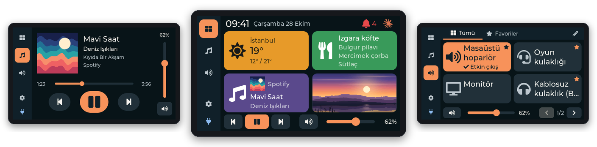

**[Download](https://github.com/egungor/stm32-desk-dashboard/releases)** ·
**[User guide (wiki)](https://github.com/egungor/stm32-desk-dashboard/wiki)** ·
**[All screens](https://github.com/egungor/stm32-desk-dashboard/wiki/Screen-Gallery)** ·
**[Build it yourself](#build-from-source)**

</div>

---

## What it does

An STM32F746G-DISCO board sits next to the keyboard, connected to the PC
by USB. A small program in the Windows tray feeds it; the board draws
everything on its 480 × 272 touchscreen and sends your taps back.

<table>
<tr>
<td width="50%" valign="top">
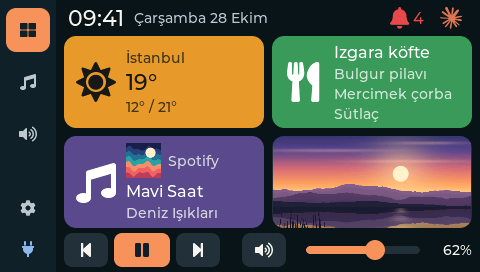
<h3>Dashboard</h3>
The time and date, the weather (the card takes the colour of the sky),
today's lunch menu, what plays now with its cover, and a picture of your
choice. A bell and the Claude Code symbol sit at the top right; media
keys and the volume at the bottom.
</td>
<td width="50%" valign="top">
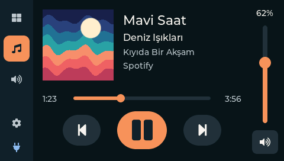
<h3>Music</h3>
Whatever plays in Windows — Spotify, Deezer, a YouTube tab — with the
cover, title, artist and app. Previous, play / pause, next, a progress
bar you can tap to jump, and the volume on the right edge.
</td>
</tr>
<tr>
<td valign="top">
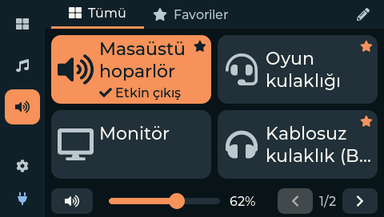
<h3>Audio</h3>
Tap an output and Windows switches to it. Names of your own, favourites,
your order, mute and volume; three layouts and four card grids.
</td>
<td valign="top">
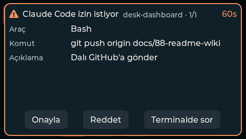
<h3>Claude Code approvals</h3>
When Claude Code on this PC asks to run a command or edit a file, the
board asks you over every screen: <b>Onayla</b>, <b>Reddet</b> or
<b>Terminalde sor</b>. Nothing is ever allowed by default.
</td>
</tr>
<tr>
<td valign="top">
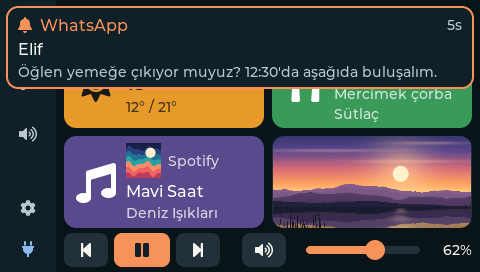
<h3>Notifications</h3>
A new Windows notification slides in as a banner for 5 seconds; the bell
counts them and opens the list. Quiet while Do not disturb is on.
</td>
<td valign="top">
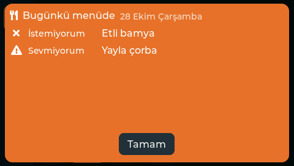
<h3>Menu of the day</h3>
The month's menu is read once from the canteen's images with the Claude
API. Keep lists of dishes you never want, don't like or love: the card
turns orange, yellow or gets a gold frame, and an 08:00 warning tells you
before lunch.
</td>
</tr>
</table>

<details>
<summary><b>More screens</b> — weather, menu, notifications, picture, settings, the Windows window</summary>
<br>

| | |
|---|---|
| 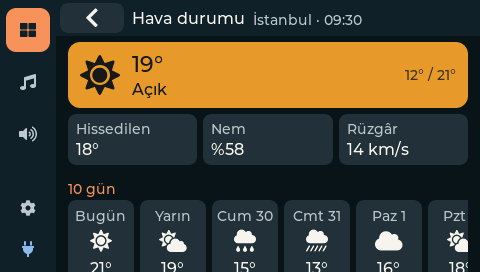 | 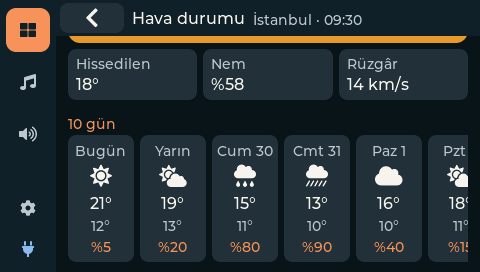 |
| Weather detail: now, feels like, humidity, wind | 10 days, swiped sideways |
| 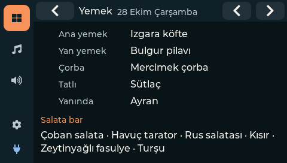 | 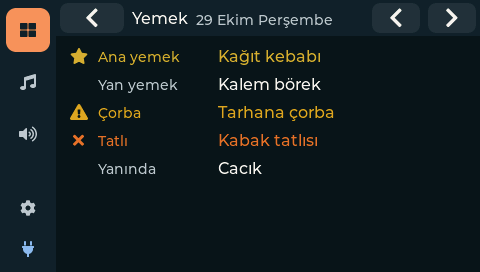 |
| The day's menu and the salad bar; ‹ › move by working day | Dishes from your lists in their colours |
| 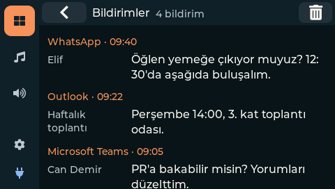 | 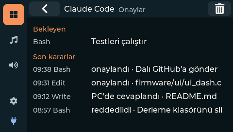 |
| The notifications list (the bin clears the notification centre) | Claude Code: waiting requests and the last decisions |
|  | 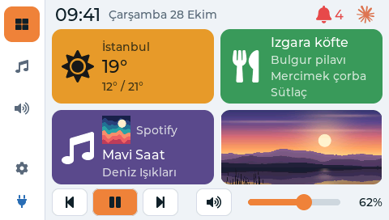 |
| A tap on the picture shows it full screen | Light theme |
| 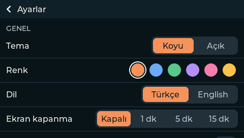 | 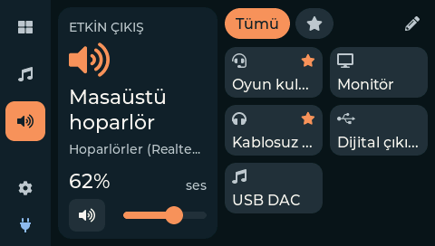 |
| Settings on the board | Audio tab, large tile layout |

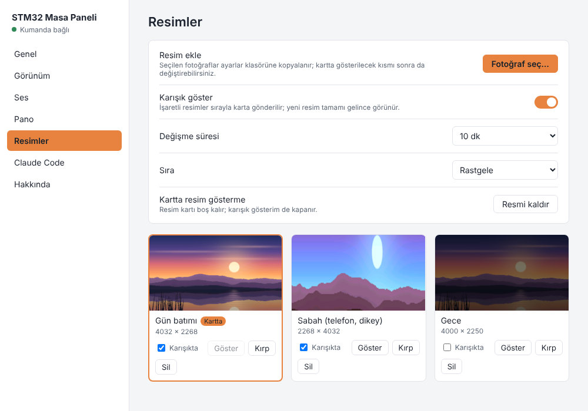

*The settings window on the PC (a left click on the tray icon): every
setting, the outputs' names, the weather place, the menu import, food
lists, the picture library with crop and shuffle, the Claude Code hook.*

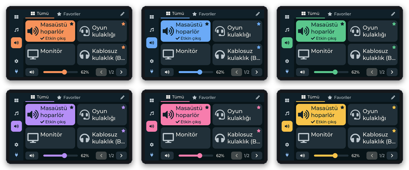

*Six accent colours, dark and light themes, Turkish and English.*

</details>

> The screens above are not photos: they are the firmware's own UI code
> (`firmware/ui`) rendered headless into the LCD's RGB565 framebuffer with
> demo data, and the settings window's page rendered in Chromium. How
> they are made: [Screen Gallery](https://github.com/egungor/stm32-desk-dashboard/wiki/Screen-Gallery).

## Quick start

You need an **STM32F746G-DISCO** board, two USB cables and a Windows PC.

1. **Flash the board.** Download `stm32-desk-dashboard-firmware-<version>.elf`
   from the [Releases page](https://github.com/egungor/stm32-desk-dashboard/releases),
   plug in the board's **ST-LINK** connector and run
   ([STM32CubeProgrammer](https://www.st.com/en/development-tools/stm32cubeprog.html)):

   ```text
   STM32_Programmer_CLI -c port=SWD -w stm32-desk-dashboard-firmware-<version>.elf -v -rst
   ```

2. **Install the PC program.** Run `stm32-desk-dashboard-setup-<version>.exe`:
   current user, no administrator rights, starts with Windows. Until the
   setup is signed (see [Code signing policy](#code-signing-policy)),
   SmartScreen may warn: "More info" → "Run anyway".
3. **Connect.** Plug the board's **USB OTG FS** connector into the PC.
   The tray icon says *Kumanda bağlı* and the board shows the Dashboard.
   A left click on the tray icon opens the settings window: set your city,
   import the menu, choose pictures, copy the Claude Code hook.

The latest releases are test pre-releases of Dashboard v1
(`v0.9.0-beta.*`); there is no v1.0.0 yet. Step by step, with every
screen: the [wiki](https://github.com/egungor/stm32-desk-dashboard/wiki/Getting-Started).

| Release file | What |
|---|---|
| `stm32-desk-dashboard-setup-<version>.exe` | Windows installer: tray program, settings window, `dashboard-host` console tools ([`installer/README.md`](installer/README.md)) |
| `stm32-desk-dashboard-firmware-<version>.elf` / `.hex` / `.bin` | Firmware (Release build; the `.bin` starts at `0x08000000`) |

The board uses USB VID:PID `1209:0002`; its sibling project, the audio
controller, uses `1209:0001`, so neither program takes the other's board.

## How it works

**Thin firmware, content from the PC.** The board knows a handful of
generic pieces — a card, a detail list, a prompt, a banner, the media
strip — and draws whatever text, colours and icons the PC sends. Weather,
menu, notifications and approvals are written on the PC.

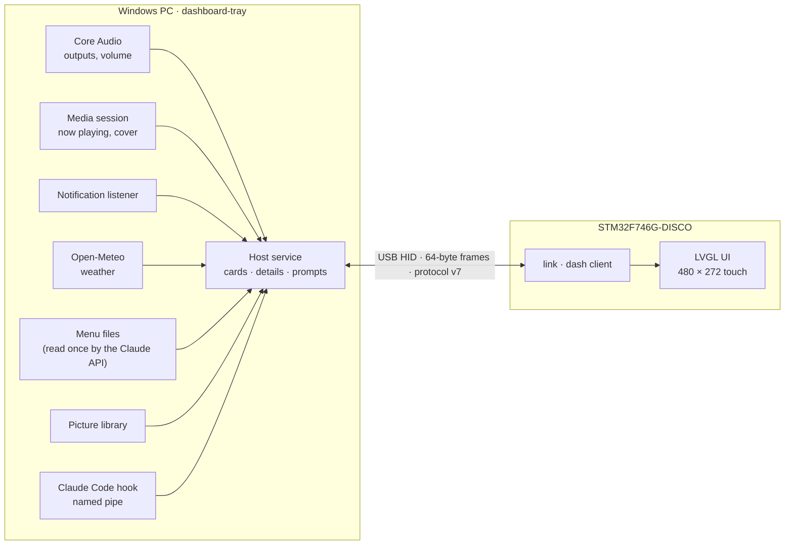

| Part | Where | In short |
|---|---|---|
| Firmware | [`firmware/`](firmware) | STM32F746 at 200 MHz, FreeRTOS, LVGL 9.5 on two SDRAM framebuffers, FT5336 touch, vendor USB HID |
| PC program | [`host/`](host) | C++17: tray program with a WebView2 settings window, `dashboard-host` console tools; Windows APIs behind small interfaces, the core also builds and is tested on Linux |
| Protocol | [`protocol/`](protocol/protocol.md) | 64-byte frames with CRC-16; text records sent in parts for cards, details, prompts and banners; RGB565 cover and picture; one C codec shared by both sides |

Design decisions are recorded as ADRs in [`docs/decisions/`](docs/decisions);
the overview is [`docs/architecture.md`](docs/architecture.md).

## Features

**Dashboard tab**
- clock and date from the PC; status icons at the top right: the bell (red until you open the list) and the Claude Code symbol (red while a request waits, yellow after a timeout, green after an allow)
- weather for one place (Open-Meteo, no key): card coloured by the weather, detail with now and 10 days
- menu of the day from the canteen's images (Claude API) or saved portal pages (no key): card, day detail with the salad bar, the next working day from an hour you choose, food lists with colours and a morning warning
- now playing with a small cover — a tap opens the Music tab
- a picture card: photos from a library on the PC, cropped as you like, shuffled every few minutes; a tap shows the picture full screen
- media keys and the Windows volume and mute on the bottom strip

**Over every screen**
- Claude Code permission requests of this PC with a 60 s countdown; requests answered in Claude Desktop or the terminal leave the board by themselves
- a 5 s banner for each new Windows notification; the list with the newest 20 and a button that clears the notification centre

**Music tab** — cover, texts, progress with seek, controls by what the player allows, volume

**Audio tab** — the default playback device in one tap; names of your own, favourites and order (on the board or on the PC); volume and mute that follow Windows; an optional volume limit when switching

**Board settings** — dark / light, six accent colours, Turkish / English, startup screen, screen timeout, a 180° flip for a board mounted upside down

**On the PC** — tray program that starts with Windows, a settings window for everything, `dashboard-host` console commands, a log of every frame, an installer without administrator rights

## Project status

Dashboard v1 is coded and released as test pre-releases; v1.0.0 follows
after the owner's last requests and the board checks
([`docs/roadmap.md`](docs/roadmap.md)). Labels as in
[`CLAUDE.md`](CLAUDE.md): nothing is called verified unless it was tried
on the board or on Windows.

| Part | State |
|---|---|
| Board bring-up: clock, SDRAM, LCD, touch, USB HID, display flip | VERIFIED on the board |
| Audio tab: switching, volume, mute, Windows changes, unplug and replug | VERIFIED on the board and Windows |
| Audio tab polish (M7): layouts, themes, favourites, aliases, settings page | Partly VERIFIED on the board; the rest REQUIRES HARDWARE ([`docs/hardware.md`](docs/hardware.md)) |
| Music tab and the media strip | VERIFIED with Deezer (2026-10-22); other players REQUIRES WINDOWS + HARDWARE |
| Dashboard cards, weather, menu, food lists, picture library | Unit tests and simulator in CI; Windows and board checks open |
| Notifications, Claude Code approvals | Unit and integration tests in CI; Windows and board checks open (Claude Code hook spike: #24) |
| Settings window | Built in CI (MSVC); Windows check open |
| Protocol v7, firmware ↔ host loopback | Codec and integration tests in CI (Linux and Windows) |

Every open check is a row in [`docs/hardware.md`](docs/hardware.md),
"Pending hardware and Windows tests".

## Build from source

```text
git clone https://github.com/egungor/stm32-desk-dashboard
cd stm32-desk-dashboard
git submodule update --init          # LVGL
```

| What | How |
|---|---|
| Firmware | [`docs/toolchain.md`](docs/toolchain.md) (ST toolchain on Windows); `tools/build-firmware-linux.sh` on Linux |
| PC program | [`host/README.md`](host/README.md) (Visual Studio 2022, CMake) |
| Protocol codec tests | [`protocol/tests`](protocol/tests/README.md) |
| Loopback integration test | [`tests/integration`](tests/integration/README.md) |
| UI simulator, test script | `tools/run-ui-simulator.sh` ([`firmware/simulator`](firmware/simulator/README.md)) |
| Documentation screenshots | `tools/doc-screens/make.sh` ([`docs/images/README.md`](docs/images/README.md)) |

<details>
<summary><b>Repository layout</b></summary>

```text
stm32-desk-dashboard/
├── firmware/
│   ├── STM32AudioController/   # STM32CubeMX project (CMake); App/ is hand-written
│   ├── ui/                     # LVGL UI, hardware independent
│   ├── link/                   # protocol client and dashboard client + tests
│   └── simulator/              # headless Linux build of the UI (tests, screenshots)
├── host/
│   ├── App/ Audio/ Hid/        # platform-independent core
│   ├── Weather/ Menu/ Media/ Notify/ Picture/ Hook/
│   ├── Platform/Windows/       # Core Audio, HID, tray, settings window, console
│   └── Tests/
├── installer/                  # Inno Setup script
├── protocol/                   # protocol.md, C codec, tests
├── tests/integration/          # firmware ↔ host loopback test
├── docs/                       # architecture, hardware, roadmap, ADRs, wiki sources, images
├── tools/                      # build, simulator, screenshots, fonts, log helpers
├── .github/                    # CI workflows, issue and PR templates
└── .claude/                    # Claude Code agents and commands
```

</details>

## Privacy

The programs send no information to other networked systems unless the
user asks for it:

- **Weather**: once you set a place (`dashboard-host weather <place>` or
  the settings window), the place name is sent to the Open-Meteo
  geocoding service and its coordinates to the Open-Meteo forecast
  service ([Open-Meteo terms and privacy](https://open-meteo.com/en/terms)).
  Without a place nothing is sent; deleting
  `%APPDATA%\stm32-desk-dashboard\weather.txt` stops the requests.
- **Menu import**: only when you import menu images with your own
  Anthropic API key, the images are sent to the Claude API
  ([Anthropic privacy policy](https://www.anthropic.com/legal/privacy)).
- Everything else stays on the PC and the board: audio devices, now
  playing, Windows notifications (their texts go to the board over USB
  and are not written to `host.log`), Claude Code requests (a local named
  pipe), pictures. There is no telemetry and no update check.
- The settings window uses the Microsoft Edge WebView2 Runtime, a part of
  Windows ([Microsoft privacy statement](https://privacy.microsoft.com/privacystatement)).

The installer shows this statement before it installs.

## Code signing policy

Free code signing provided by [SignPath.io](https://about.signpath.io/),
certificate by [SignPath Foundation](https://signpath.org/).

What is signed: the Windows installer `stm32-desk-dashboard-setup-<version>.exe`
of a release, built in GitHub Actions from this repository
(`.github/workflows/host-installer.yml`). Every signing request is
approved by hand. The firmware files are not signed (the board does not
check signatures).

Team roles:

| Role | Members |
|---|---|
| Authors (commit without further review) | [egungor](https://github.com/egungor) |
| Reviewers (review changes from others) | [egungor](https://github.com/egungor) |
| Approvers (approve each signing request) | [egungor](https://github.com/egungor) |

Changes are also written with the help of Claude Code (an AI coding
assistant); each one goes through a pull request that the owner merges.

## License

[MIT](LICENSE), for the code of this project. Third-party components keep
their own licences:

| Component | Where | Licence |
|---|---|---|
| nlohmann/json | host (`host/third_party/nlohmann`) | MIT |
| Microsoft WebView2 SDK (headers, static loader) | host, settings window (fetched by CMake) | BSD-3-Clause |
| LVGL | firmware (`firmware/ui`, submodule) | MIT |
| FreeRTOS | firmware | MIT |
| STM32Cube HAL, BSP | firmware | BSD-3-Clause |
| CMSIS | firmware | Apache-2.0 |
| STM32 USB Device Library | firmware | ST SLA0044 |

The installer carries the notices of the host's components
([`installer/THIRD-PARTY-NOTICES.txt`](installer/THIRD-PARTY-NOTICES.txt)).

## Development model

This repository continues
[stm32-audio-controller](https://github.com/egungor/stm32-audio-controller)
(its history, milestones M0–M7 and ADR-001…004 are kept here) and is
developed with **Claude Code** as the AI development environment. GitHub
holds the source, issues, pull requests, reviews, CI, releases and the
public documentation; the human developer decides the architecture, runs
the hardware and Windows checks and merges.

> [!IMPORTANT]
> An AI agent must never claim hardware functionality was verified unless
> it was actually tested on the physical board.

See [`CLAUDE.md`](CLAUDE.md), [`AGENTS.md`](AGENTS.md),
[`docs/development-workflow.md`](docs/development-workflow.md) and
[`docs/architecture.md`](docs/architecture.md).
